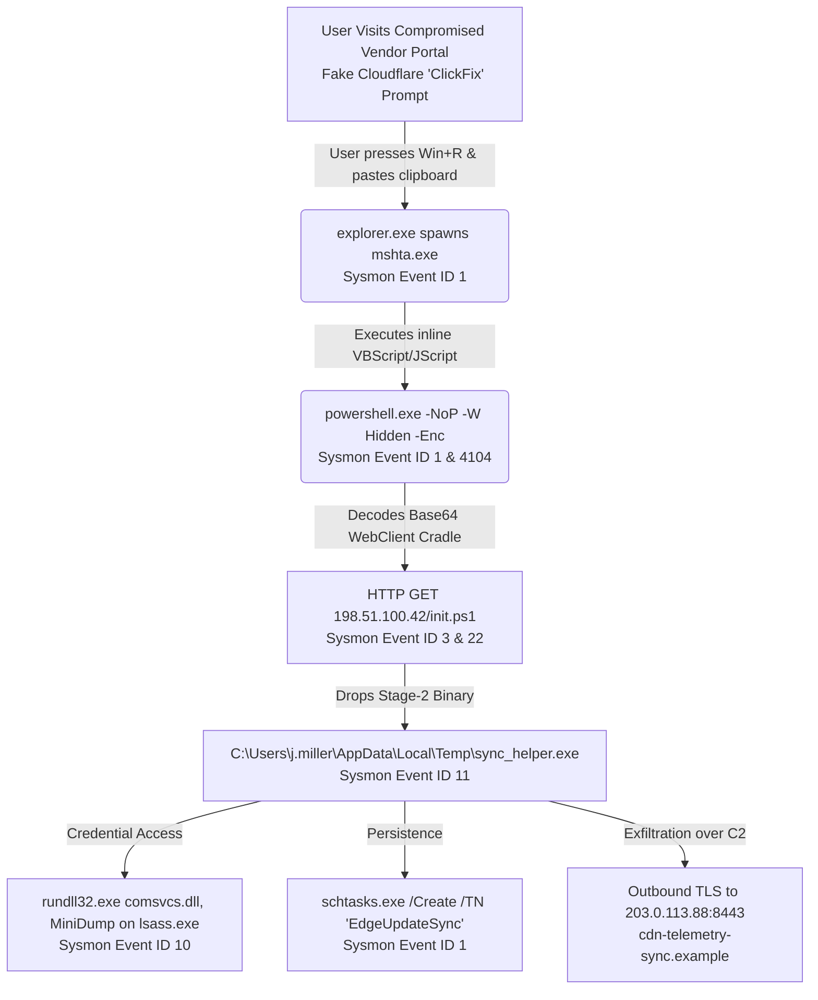

# CSIRT Case 042: "ClickFix" to InfoStealer & Credential Access Intrusion Analysis


-yellow)

## Executive Overview
This repository contains the end-to-end **Computer Security Incident Response Team (CSIRT)** artifacts for **Case 042**, a simulated multi-stage intrusion on workstation `WKSTN-FIN-09` (User: `j.miller`). 

The intrusion began with a **ClickFix social engineering lure** (fake browser verification prompt) that tricked the user into executing a malicious `mshta.exe` command via the Windows Run dialog (`Win + R`). This spawned an obfuscated `powershell.exe -EncodedCommand` cradle, deployed a Stage-2 credential stealer (`LummaC2` variant), dumped `lsass.exe` process memory via `comsvcs.dll`, established persistence via a Scheduled Task, and initiated C2 exfiltration.

### Core Portfolio Capabilities Demonstrated
1. **Log Triage & Telemetry Analysis:** Parsing raw Windows Sysmon & Security Event JSON telemetry (`data/sysmon_telemetry.json`), filtering out baseline enterprise noise.
2. **SOAR / Python Automation (`src/triage_engine.py`):** Zero-dependency Python script that ingests Sysmon telemetry, automatically detects and decodes Base64 PowerShell payloads, extracts and **defangs** network/host IOCs, maps events to MITRE ATT&CK, and outputs a structured Markdown triage report.
3. **Detection Engineering (`detections/`):** Production-ready **Sigma** and **YARA** rules written to detect the adversary's behavioral TTPs and memory artifacts.
4. **Formal Post-Incident Documentation (`reports/`):** Complete NIST SP 800-61r3 Incident Response Report detailing root cause, timeline reconstruction, containment, eradication, and recovery playbooks.

---

## Intrusion Attack Flow (Mermaid.js)



---

## MITRE ATT&CK® Matrix Mapping

| Tactic | Technique ID | Technique Name | Observed Artifact / Telemetry |
| :--- | :--- | :--- | :--- |
| **Initial Access** | `T1566.002` | Phishing: Spearphishing Link | User directed to fake verification portal via compromised vendor link |
| **Execution** | `T1204.004` | User Execution: Malicious Copy and Paste | User executed clipboard payload via `Win + R` (`explorer.exe` parent) |
| **Defense Evasion** | `T1218.005` | System Binary Proxy Execution: Mshta | `mshta.exe` used as Living-off-the-Land Binary (LOLBin) proxy |
| **Execution** | `T1059.001` | Command and Scripting Interpreter: PowerShell | `powershell.exe -NoP -W Hidden -EncodedCommand SUVY...` |
| **Persistence** | `T1053.005` | Scheduled Task/Job: Scheduled Task | `schtasks.exe /create /sc minute /mo 30 /tn "EdgeUpdateSync"` |
| **Credential Access** | `T1003.001` | OS Credential Dumping: LSASS Memory | `rundll32.exe C:\Windows\System32\comsvcs.dll, MiniDump 684` |
| **Command & Control** | `T1071.001` | Application Layer Protocol: Web Protocols | Outbound C2 beacon to `203.0.113.88:8443` (`cdn-telemetry-sync.example`) |

---

## Running the Automated Triage Engine

### Option A: In the GitHub Browser (Zero Setup)
Navigate to the **Actions** tab in this repository to view the automated cloud execution of `src/triage_engine.py`, or inspect the generated output directly in [`reports/automated_triage_output.md`](reports/automated_triage_output.md).

### Option B: Local CLI Execution
```bash
python3 src/triage_engine.py
```

---

## Repository Navigation
* **[Full NIST Post-Incident Report (Case 042)](reports/INCIDENT_REPORT_CASE_042.md)**
* **[Automated Python Triage Script](src/triage_engine.py)**
* **[Raw Sysmon Telemetry Dataset](data/sysmon_telemetry.json)**
* **[Sigma Detection Rule (ClickFix / Mshta -> PowerShell)](detections/sigma_clickfix_powershell.yml)**
* **[YARA Rule (LummaC2 Loader Artifacts)](detections/yara_lumma_loader_memory.yar)**
